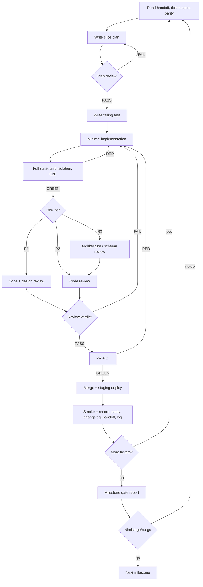
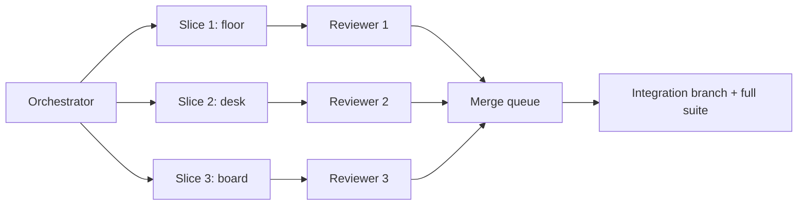

# Orchestration: goal loop, graph loop and parallel development

Short answer: **both, at different levels.** A goal loop at the milestone level; a graph (DAG) at the slice level; parallel workers only where the graph has independent branches. **LangGraph is not the right tool for the build itself** — it is a framework for stateful LLM applications, not a project manager. It becomes a candidate for the product’s M6 AI layer, behind an adapter, when there is a multi-step agent with checkpoints and human approvals. The build’s durable graph is the repo, the backlog, git and CI.

## 1. Goal loop vs graph loop

| | Goal loop | Graph loop |
| --- | --- | --- |
| Shape | Objective → plan → act → observe → verify → reflect → update → repeat | Nodes and edges with explicit state, branches, retries and checkpoints |
| Best for | Ambiguous, evolving work; a long milestone; “keep going until the gate” | Repeatable pipelines, many dependencies, parallel branches, resumability, auditability |
| Risk | Drift, scope creep, “busy but not done” | A rigid graph that goes stale when the plan changes; orchestration overhead |
| Use here | **Milestones**: M0 → M6, with a gate and a go/no-go | **Slices**: intake → plan → red → green → verify → review → merge → record; **audits**: fan-out over many files/screens |

**The hybrid:** the goal loop decides *what* and *why*; the graph decides *how* and *in what order*; the gate decides *whether to continue*. Neither replaces judgment.

## 2. The three layers

### Layer 1 — Milestone goal

For each milestone (M0, M1a, M1b, M2, M3, M4a, M4b, M5, M6) the goal is written down:

- **Objective:** the user-visible outcome, in one sentence.
- **Success criteria:** the gate checklist, with tests and parity rows.
- **Constraints:** stack, data residency, no AGPL, RLS, no production from a session.
- **Budget:** a time box; a token/context budget; the external inputs it needs.
- **Stop conditions:** the gate is green; a blocker repeats; a decision needs Nimish; the budget is exhausted.

The goal is persisted in the repo (`docs/plan/gates/M<n>.md` at the end, `docs/HANDOFF.md` throughout), and in DSH as a persisted goal when the milestone starts. A new session resumes the objective from the repo, not from chat memory.

### Layer 2 — Slice DAG

Every ticket runs the same graph. This is the “graph loop” in practice:

Every edge is explicit. A failure goes back to the right node, not “try again” from the start. A human gate is a node, not an email.

### Layer 3 — Fan-out graph (parallel)

Some work is genuinely independent: six screens, four analytics formulas, ten audit angles, a batch of locale strings. For those, the orchestrator fans out:

The fan-out is only allowed when the branches do not write the same files and their interfaces are frozen first.

## 3. Parallelism policy

**Start sequential, then widen.** The bottleneck is review and integration, not typing. More agents on a shared schema produces conflicts, not speed.

| Phase | Parallel workers | What may run in parallel | What must stay serial |
| --- | --- | --- | --- |
| Foundation (M0) | 1 + reviewer | Docs, ADRs, CI, a spike | Schema, auth, tenancy, migrations, contracts |
| M1a ticket core | 2–3 | Domain state machine, API contract tests, floor UI against mocks, desk UI against mocks | The schema, the `transition()` signature, the figure definitions |
| M1b parity/cutover | 3–4 | PDF template, live board, offline outbox, import fixture, Gujarati strings | The import reconciliation, the cutover runbook |
| M2/M3 | 3–4 | SLA engine, escalation rules, handback UI, WhatsApp adapter, voice adapter | Timer semantics, webhook routing, consent model |
| M4a/M4b | 4–6 | Independent analytics screens/formulas, PM calendar, failure codes, fixtures | The engine interface, the answer-key format, the KPI definitions |
| Audits/tests/docs | 5–8 | Security audit, accessibility audit, dependency audit, screen-by-screen review, test-coverage audit | Any code change that comes out of the audit |

**Rules for parallel work:**

1. **Contract first.** Freeze the Zod schema, the DB table, the API shape, the component props and the design tokens before workers start. A worker who needs a new field stops and asks the planner; they do not invent one.
2. **One writer per file.** Two workers never edit the same file. Shared files (`package.json`, lockfile, schema, generated types, i18n catalogue) have a single owner per integration window.
3. **One worktree per slice.** Each worker gets its own git worktree/branch (`subagent` `cwd`), so a failed experiment cannot dirty another slice.
4. **One merge queue.** PRs merge one at a time, rebased on `main`, full CI, then the next. No batch merge.
5. **Integration branch for risky fan-outs.** If several branches must land together, they share an integration branch and one integrate-and-verify ticket; green is promised only there.
6. **Feature flags** for a half-built screen or a new job that must not run in production yet.
7. **A worker stops on ambiguity.** The determinism rule beats “keep going”: if the plan is silent, the worker returns the question; the orchestrator updates the plan.

## 4. The orchestrator

In this build the orchestrator is the lead agent (me). It is not a separate product, and it is not a human project manager. Its job:

- Maintain the backlog and the dependency graph; choose the next frontier.
- Freeze contracts before fan-out; assign disjoint slices; keep one writer per file.
- Run the merge queue; ensure every PR has a plan, tests, a reviewer and green CI.
- Keep the risk register, the parity count and the handoff current.
- Resolve conflicts between workers, or escalate to a decision record.
- Stop at gates; write the gate report; ask the product owner only product/business questions.
- Refuse to let a worker bypass tests, weaken a test, or touch production.

**DSH tools it uses:**

| Tool | Use |
| --- | --- |
| `todo_write` | The session’s task list; visible progress |
| `subagent` | A fresh-context worker or reviewer with a constructed brief; `cwd` for a worktree |
| `subagent_fork` | Only when a task genuinely needs this conversation’s context; not for independent review |
| `workflow` | A scripted fan-out over many independent items (audits, screens, fixtures) with phases and structured results |
| `create_goal` / `update_goal` | A persisted milestone objective; complete only when the gate is met |
| `handoff` | Compact the session into a document at the context limit |
| `bash`, `read`, `write`, `edit` | The actual work: code, tests, git, CI, Docker |
| `web_fetch` / `web_search` | Current library docs and facts, never from memory |

**What the orchestrator does not do:** run ten agents on the same schema, let a worker mark its own review as PASS, merge a red PR, or claim a milestone without a gate report.

## 5. Worker and reviewer contracts

**Worker brief (constructed, not the whole chat):**

- The ticket and its acceptance criteria.
- The slice plan: files, interfaces, fields, tests.
- The boundaries: what it may not touch.
- The definition of done: tests, no secrets, i18n, parity update.
- The stop rule: if the plan is silent, stop and ask; do not guess.

**Reviewer brief:**

- The plan, the diff, the CI result and the fixed checklist.
- No author reasoning, no conversation history.
- Verdict `PASS` or `FAIL`, with numbered findings: `[item] evidence (file:line) -> fix`.
- Read-only. No edits.

**Final integration review:** after a fan-out, one broad review of the integrated branch against the milestone goal, not just per-slice reviews.

## 6. Failure, retry and rollback

- A failing test goes back to the implementation node, not to the plan, unless the plan is wrong.
- A review finding goes back to the implementation node; the same finding twice means the plan or the interface is wrong, and the orchestrator revises it.
- A worker that cannot proceed is stopped and its slice quarantined; the queue moves to the next independent slice.
- A bad merge is reverted; a bad deploy is rolled back by tag; a bad migration is expand-and-contract, so the previous app version still runs.
- A repeated blocker (three rounds) becomes `blocked-external` with a written need; it does not loop forever.
- No silent pass: a skipped test, a disabled check or a “temporary” bypass is a failed review.

## 7. Build observability

The build itself has metrics, reported weekly and at each gate:

- Queue depth and blocked age.
- Cycle time per slice; first-pass review yield.
- Escaped defects per milestone.
- Parity burn-down (`done / total`).
- Test counts and flake rate.
- Rollbacks per month.
- Token/context spend per milestone, and infrastructure cost.
- Open security findings.

If the numbers move the wrong way, the orchestrator fixes the process before adding workers.

## 8. Why not LangGraph for the build

LangGraph is a good library for **stateful, multi-actor LLM applications**: nodes, edges, shared state, checkpointing, human-in-the-loop, streaming. That is a product runtime, not a software project manager.

Using it to orchestrate this build would add:

- A second runtime (Python) and a second state store alongside Postgres, git and CI.
- A second orchestration system alongside DSH’s `workflow`/`subagent` and the repo’s backlog.
- Less repo-native observability: the graph state would live in a checkpoint database, not in files a human can read.
- A dependency and a model/provider assumption before the product needs it.

The build already has a graph: the backlog’s blocking edges, the slice DAG, the merge queue, CI, and the gate reports. It is durable, inspectable, and does not need a framework to be a graph.

**When LangGraph (or an equivalent) becomes a candidate:**

- M6, if the product ships a multi-step AI workflow with durable checkpoints, retries, human approvals and multiple tools (for example intake → code suggestion → confirmation → learning).
- If we need to pause an AI workflow for a human and resume it hours later, across sessions.
- If the AI layer has enough nodes and branches that a hand-written TypeScript state machine becomes harder to reason about than a graph library.

At that point: a written ADR, a data-residency and PII note, a cost cap, an adapter boundary so the product does not depend on the framework, and an evaluation harness. **Not now.** For M6, a simple TypeScript state machine plus our own `ai_suggestion`/`ai_evaluation` tables may still be the simpler answer.

## 9. What this means for a normal week

- **Monday:** the orchestrator reads the handoff, picks the frontier, freezes the week’s contracts, assigns 2–3 disjoint slices.
- **Tue–Thu:** workers implement and test in worktrees; reviewers review in fresh contexts; the merge queue lands one PR at a time; staging deploys on each merge.
- **Friday:** integration review, parity count, handoff, a plain-English note for Nimish, and the next week’s plan.
- **At a gate:** stop, write the gate report, Nimish tests, go/no-go.

That is the whole orchestration. It is deliberately less exciting than “a swarm of agents”: it is a queue, a graph, a reviewer and a gate.
