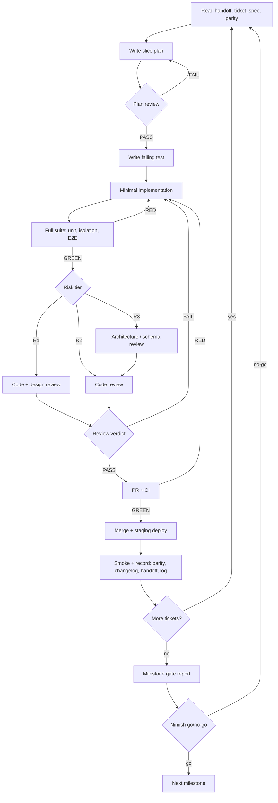
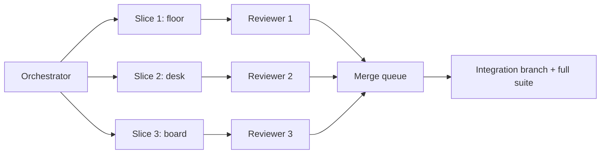

# Orchestration: goal loop, graph loop and parallel development

Short answer: **both, at different levels.** A goal loop at the milestone level; a graph (DAG) at the slice level; parallel workers only where the graph has independent branches. **LangGraph is not the right tool for the build itself** — it is a framework for stateful LLM applications, not a project manager. It becomes a candidate for the product’s M6 AI layer, behind an adapter, when there is a multi-step agent with checkpoints and human approvals. The build’s durable graph is the repo, the backlog, git and CI. Context is budgeted at 50–70%: hand off early, never at 99%.

## 1. Goal loop vs graph loop

|          | Goal loop                                                               | Graph loop                                                                                                              |
| -------- | ----------------------------------------------------------------------- | ----------------------------------------------------------------------------------------------------------------------- |
| Shape    | Objective → plan → act → observe → verify → reflect → update → repeat   | Nodes and edges with explicit state, branches, retries and checkpoints                                                  |
| Best for | Ambiguous, evolving work; a long milestone; “keep going until the gate” | Repeatable pipelines, many dependencies, parallel branches, resumability, auditability                                  |
| Risk     | Drift, scope creep, “busy but not done”                                 | A rigid graph that goes stale when the plan changes; orchestration overhead                                             |
| Use here | **Milestones**: M0 → M6, with a gate and a go/no-go                     | **Slices**: intake → plan → red → green → verify → review → merge → record; **audits**: fan-out over many files/screens |

**The hybrid:** the goal loop decides _what_ and _why_; the graph decides _how_ and _in what order_; the gate decides _whether to continue_. Neither replaces judgment.

## 2. The three layers

### Layer 1 — Milestone goal

For each milestone (M0, M1a, M1b, M2, M3, M4a, M4b, M5, M6) the goal is written down:

- **Objective:** the user-visible outcome, in one sentence.
- **Success criteria:** the gate checklist, with tests and parity rows.
- **Constraints:** stack, data residency, no AGPL, RLS, no production from a session.
- **Budget:** a time box; a token/context budget; the external inputs it needs.
- **Stop conditions:** the gate is green; a blocker repeats; a decision needs Nimish; the budget is exhausted.

The goal is persisted in the repo (`docs/plan/gates/M<n>.md` at the end, `docs/HANDOFF.md` throughout), and in DSH as a persisted goal when the milestone starts. A new session resumes the objective from the repo, not from chat memory.

### Layer 2 — Slice DAG

Every ticket runs the same graph. This is the “graph loop” in practice:



Every edge is explicit. A failure goes back to the right node, not “try again” from the start. A human gate is a node, not an email.

### Layer 3 — Fan-out graph (parallel)

Some work is genuinely independent: six screens, four analytics formulas, ten audit angles, a batch of locale strings. For those, the orchestrator fans out:



The fan-out is only allowed when the branches do not write the same files and their interfaces are frozen first.

## 3. Parallelism policy

**Start sequential, then widen.** The bottleneck is review and integration, not typing. More agents on a shared schema produces conflicts, not speed.

| Phase              | Parallel workers | What may run in parallel                                                                            | What must stay serial                                            |
| ------------------ | ---------------- | --------------------------------------------------------------------------------------------------- | ---------------------------------------------------------------- |
| Foundation (M0)    | 1 + reviewer     | Docs, ADRs, CI, a spike                                                                             | Schema, auth, tenancy, migrations, contracts                     |
| M1a ticket core    | 2–3              | Domain state machine, API contract tests, floor UI against mocks, desk UI against mocks             | The schema, the `transition()` signature, the figure definitions |
| M1b parity/cutover | 3–4              | PDF template, live board, offline outbox, import fixture, Gujarati strings                          | The import reconciliation, the cutover runbook                   |
| M2/M3              | 3–4              | SLA engine, escalation rules, handback UI, WhatsApp adapter, voice adapter                          | Timer semantics, webhook routing, consent model                  |
| M4a/M4b            | 4–6              | Independent analytics screens/formulas, PM calendar, failure codes, fixtures                        | The engine interface, the answer-key format, the KPI definitions |
| Audits/tests/docs  | 5–8              | Security audit, accessibility audit, dependency audit, screen-by-screen review, test-coverage audit | Any code change that comes out of the audit                      |

**Rules for parallel work:**

1. **Contract first.** Freeze the Zod schema, the DB table, the API shape, the component props and the design tokens before workers start. A worker who needs a new field stops and asks the planner; they do not invent one.
2. **One writer per file.** Two workers never edit the same file. Shared files (`package.json`, lockfile, schema, generated types, i18n catalogue) have a single owner per integration window.
3. **One worktree per slice.** Each worker gets its own git worktree/branch (`subagent` `cwd`), so a failed experiment cannot dirty another slice.
4. **One merge queue.** PRs merge one at a time, rebased on `main`, full CI, then the next. No batch merge.
5. **Integration branch for risky fan-outs.** If several branches must land together, they share an integration branch and one integrate-and-verify ticket; green is promised only there.
6. **Feature flags** for a half-built screen or a new job that must not run in production yet.
7. **A worker stops on ambiguity.** The determinism rule beats “keep going”: if the plan is silent, the worker returns the question; the orchestrator updates the plan.

## 4. The orchestrator

In this build the orchestrator is the lead agent (me). It is not a separate product, and it is not a human project manager. Its job:

- Maintain the backlog and the dependency graph; choose the next frontier.
- Freeze contracts before fan-out; assign disjoint slices; keep one writer per file.
- Run the merge queue; ensure every PR has a plan, tests, a reviewer and green CI.
- Keep the risk register, the parity count and the handoff current.
- Resolve conflicts between workers, or escalate to a decision record.
- Stop at gates; write the gate report; ask the product owner only product/business questions.
- Refuse to let a worker bypass tests, weaken a test, or touch production.

**DSH tools it uses:**

| Tool                            | Use                                                                                                           |
| ------------------------------- | ------------------------------------------------------------------------------------------------------------- |
| `todo_write`                    | The session’s task list; visible progress                                                                     |
| `subagent`                      | A fresh-context worker or reviewer with a constructed brief; `cwd` for a worktree                             |
| `subagent_fork`                 | Only when a task genuinely needs this conversation’s context; not for independent review                      |
| `workflow`                      | A scripted fan-out over many independent items (audits, screens, fixtures) with phases and structured results |
| `create_goal` / `update_goal`   | A persisted milestone objective; complete only when the gate is met                                           |
| `handoff`                       | Compact the session into a document at the context limit                                                      |
| `bash`, `read`, `write`, `edit` | The actual work: code, tests, git, CI, Docker                                                                 |
| `web_fetch` / `web_search`      | Current library docs and facts, never from memory                                                             |

**What the orchestrator does not do:** run ten agents on the same schema, let a worker mark its own review as PASS, merge a red PR, or claim a milestone without a gate report.

## 5. Worker and reviewer contracts

**Worker brief (constructed, not the whole chat):**

- The ticket and its acceptance criteria.
- The slice plan: files, interfaces, fields, tests.
- The boundaries: what it may not touch.
- The definition of done: tests, no secrets, i18n, parity update.
- The stop rule: if the plan is silent, stop and ask; do not guess.

**Reviewer brief:**

- The plan, the diff, the CI result and the fixed checklist.
- No author reasoning, no conversation history.
- Verdict `PASS` or `FAIL`, with numbered findings: `[item] evidence (file:line) -> fix`.
- Read-only. No edits.

**Final integration review:** after a fan-out, one broad review of the integrated branch against the milestone goal, not just per-slice reviews.

## 6. Failure, retry and rollback

- A failing test goes back to the implementation node, not to the plan, unless the plan is wrong.
- A review finding goes back to the implementation node; the same finding twice means the plan or the interface is wrong, and the orchestrator revises it.
- A worker that cannot proceed is stopped and its slice quarantined; the queue moves to the next independent slice.
- A bad merge is reverted; a bad deploy is rolled back by tag; a bad migration is expand-and-contract, so the previous app version still runs.
- A repeated blocker (three rounds) becomes `blocked-external` with a written need; it does not loop forever.
- No silent pass: a skipped test, a disabled check or a “temporary” bypass is a failed review.

## 7. Build observability

The build itself has metrics, reported weekly and at each gate:

- Queue depth and blocked age.
- Cycle time per slice; first-pass review yield.
- Escaped defects per milestone.
- Parity burn-down (`done / total`).
- Test counts and flake rate.
- Rollbacks per month.
- Token/context spend per milestone, and infrastructure cost.
- Open security findings.

If the numbers move the wrong way, the orchestrator fixes the process before adding workers.

## 8. Why not LangGraph for the build

LangGraph is a good library for **stateful, multi-actor LLM applications**: nodes, edges, shared state, checkpointing, human-in-the-loop, streaming. That is a product runtime, not a software project manager.

Using it to orchestrate this build would add:

- A second runtime (Python) and a second state store alongside Postgres, git and CI.
- A second orchestration system alongside DSH’s `workflow`/`subagent` and the repo’s backlog.
- Less repo-native observability: the graph state would live in a checkpoint database, not in files a human can read.
- A dependency and a model/provider assumption before the product needs it.

The build already has a graph: the backlog’s blocking edges, the slice DAG, the merge queue, CI, and the gate reports. It is durable, inspectable, and does not need a framework to be a graph.

**When LangGraph (or an equivalent) becomes a candidate:**

- M6, if the product ships a multi-step AI workflow with durable checkpoints, retries, human approvals and multiple tools (for example intake → code suggestion → confirmation → learning).
- If we need to pause an AI workflow for a human and resume it hours later, across sessions.
- If the AI layer has enough nodes and branches that a hand-written TypeScript state machine becomes harder to reason about than a graph library.

At that point: a written ADR, a data-residency and PII note, a cost cap, an adapter boundary so the product does not depend on the framework, and an evaluation harness. **Not now.** For M6, a simple TypeScript state machine plus our own `ai_suggestion`/`ai_evaluation` tables may still be the simpler answer.

## 9. What this means for a normal week

- **Monday:** the orchestrator reads the handoff, picks the frontier, freezes the week’s contracts, assigns 2–3 disjoint slices.
- **Tue–Thu:** workers implement and test in worktrees; reviewers review in fresh contexts; the merge queue lands one PR at a time; staging deploys on each merge.
- **Friday:** integration review, parity count, handoff, a plain-English note for Nimish, and the next week’s plan.
- **At a gate:** stop, write the gate report, Nimish tests, go/no-go.

That is the whole orchestration. It is deliberately less exciting than “a swarm of agents”: it is a queue, a graph, a reviewer and a gate.

---

## 10. Model routing: DeepSeek plans and reviews, a hosted free coder writes the code

**Decision (12 November 2026).** The build uses two model families for different jobs:

| Role       | Route                                               | Writes product code? | Job                                                         |
| ---------- | --------------------------------------------------- | -------------------- | ----------------------------------------------------------- |
| Planner    | `deepseek-account/deepseek-flash`                   | no                   | Read the milestone, write slice plans and microtask packets |
| Coder      | `openrouter/nvidia/nemotron-3-ultra-550b-a55b:free` | **yes**              | Failing test, minimal implementation, bug fix, test run     |
| Reviewer   | `deepseek-account/deepseek-flash`                   | no                   | Fresh-context plan/code review, evidence and PASS/FAIL      |
| Integrator | `deepseek-account/deepseek-flash`                   | no                   | Merge queue, full suite, docs, gate report, handoff         |
| Probe      | `openrouter/cohere/north-mini-code:free`            | no                   | STEP 0 route check: one word, about two seconds             |

The machine-readable values are in `docs/orchestration.yaml`; `pnpm orchestration:check` validates them. The working rules are below and in `AGENTS.md`.

**Route gate.** A model list is not a route. `list_subagent_models` reads the session allowlist from the profile file and returns models even when the running harness has no provider registered; dispatch a one-word probe (`cohere`, about 2 s) before the first coder packet of a session. The coder route is the free tier: on a 429 stop and report, never silently switch to a paid model. Local TwIL (`ollama/twil-coder:24k`) remains a development-only fallback, not a shipping coder.

### 10.1 Why this split

The hosted free coder costs nothing per token, is a different model family from the reviewer, and answered the gate: no scope violations across three fixtures, and a real microtask passed after one review failure and fix. It is not a senior engineer: it is slow on long files, it will follow a wrong packet exactly, and it benefits more than a paid model from a frozen contract and a named red test. DeepSeek Flash is used only where judgment compounds — planning and review — so the paid budget buys decisions, not typing.

The split is also the maker–checker separation: the model that writes a line never passes it.

### 10.2 What a microtask is

A microtask is the smallest **red→green** change that proves one acceptance assertion. It is not a layer (“backend”, “frontend”), a file, or a commit.

| Limit                      | Value      | Why                                                      |
| -------------------------- | ---------- | -------------------------------------------------------- |
| Acceptance assertions      | 1          | One Given/When/Then; no “while we are here”              |
| Source files touched       | 3          | Fits the 8B context and keeps the diff reviewable        |
| New files                  | 1          | A new module is a design decision, not a microtask       |
| Changed lines              | 150        | Below the lean PR budget and inside one model response   |
| Prompt/context             | 20k tokens | Keeps a microtask fast and reviewable; the window is 1M  |
| Attempts before escalation | 3          | The same failure three times is a plan/interface defect  |
| Open design decisions      | 0          | The slice plan names files, interfaces, fields and tests |

Rules:

- The failing test is written **first**; the coder reports the red command and why it failed, then makes it green.
- The coder may not edit a test to make it pass, touch a file outside its write scope, or invent a field, endpoint or dependency. It stops and returns the question.
- Split by **assertion**, never by layer. If a change cannot be proved by one assertion, it is at least two microtasks.
- The packet names any cross-test isolation the suite needs (fixtures, machines, tenants, project variants). A green test that breaks a sibling spec is a failed microtask.
- A bug fix is one microtask: the regression test fails for the right reason, then the root cause is fixed. A symptom patch is a failed microtask.
- Microtasks do not each get a PR. A ticket is still one branch, one PR, one review and one merge (`docs/BUILD-PROTOCOL.md` §2).

### 10.3 MECE at the milestone, not at the file

“MECE” here means **mutually exclusive, collectively exhaustive at the outcome level**. Code tasks always have dependencies; pretending they are independent is the failure mode. Keep three ledgers:

1. **Outcome ledger.** Every gate criterion in `docs/spec/SPEC.md` and `docs/plan/backlog.md` has exactly one owning ticket. No criterion without a ticket; no ticket without a criterion.
2. **Ticket ledger.** Every acceptance assertion in the ticket's slice plan has exactly one microtask. No duplicate owner; no unproved assertion.
3. **Write ledger.** Every microtask names its write scope. Two microtasks in the same parallel wave never share a file. Shared files (`package.json`, schema, lockfile, i18n) get one owner per integration window.

Checks before a wave starts:

- **Exhaustive:** walk every gate criterion and every slice-plan assertion; each resolves to one microtask and one test. Anything unresolved is a planning defect, not a coder problem.
- **Exclusive:** no two microtasks claim the same assertion; no two ready microtasks share a write scope; no microtask exists only because it is interesting.
- **Ordered:** dependencies are explicit; a task is ready only when its blockers are done or waived.
- **Traceable:** every changed line traces to the microtask's assertion; anything else is scope creep.

At the end of the milestone, the gate report maps criteria → tickets → tests → evidence. If the map has a hole, the milestone is not done.

### 10.4 The coder packet

Every TwIL child gets a constructed packet, never the conversation:

```text
TASK <id> — <ticket>
OUTCOME: the one user-visible or contract-visible result.
ACCEPTANCE: Given / When / Then.
WRITE SCOPE: exact files; nothing else may be edited.
READ FIRST: exact files and line ranges.
CONTRACT: interfaces, fields, schemas and error behaviour already frozen by the plan.
RED: the test command and the expected failure.
GREEN: the command that must pass; the smallest implementation.
OUT OF SCOPE: what not to build, refactor or reformat.
STOP: if the plan is silent or a contract is missing, return the question; do not guess.
```

One child per microtask, with `provider: ollama` and `model: twil-coder:24k`. The child has filesystem and test tools; it does not get the milestone discussion, the spec dump or the reviewer's reasoning.

### 10.5 The loop

0. **Probe.** Dispatch a one-word request to the probe route (`openrouter/cohere/north-mini-code:free`, about 2 s) before the first coder packet of the session. A model list is not a route.
1. **Goal.** The milestone is a persisted goal (`/goal` in the UI or `create_goal`), with the gate as the objective. `max_goal_rounds` is capped; the goal is not “keep coding forever”.
2. **Frontier.** Take the first unblocked ticket. The planner writes or refreshes `docs/slices/<ticket>.md`; a fresh plan reviewer passes it.
3. **Decompose.** Write the ticket ledger: microtasks, assertions, write scopes, tests, dependencies. Run the MECE checks in §10.3.
4. **Code.** Dispatch one TwIL child with one packet. Run the red test, then green, then the smallest relevant suite. Retry at most three times with the actual failure output.
5. **Review.** Only after tests are green, dispatch a fresh DeepSeek reviewer with the plan, diff and test output. It is read-only and returns PASS or FAIL with numbered `file:line` findings. It never sees the coder's reasoning.
6. **Fix.** Send findings to TwIL. A repeated finding means the plan or interface is wrong; the planner revises the plan, not the test.
7. **Integrate.** When the ticket ledger is exhausted, run the full suite/CI, one PR, one reviewer, one merge. Record parity, changelog, handoff and log.
8. **Gate.** Stop at the milestone gate, write `docs/plan/gates/M<n>.md`, ask the product owner only the go/no-go and product questions.

For R2/R3 work, review each microtask before moving on. For R1, the ticket diff is the review unit, because a UI-only change is cheap to inspect once. This is a cost decision, not a quality exemption: R3 still gets plan, architecture, schema, security and human sign-off.

### 10.6 Cost and concurrency

- DeepSeek Flash is used for planning and review only. Do not ask it to read the whole repo; give it the ticket, the slice plan, the diff and the evidence.
- One hosted coder at a time. The free tier rate-limits bursts, and one coder keeps the queue and the review honest; parallel children add context-switch cost without throughput.
- Free inference has no per-token bill, but it has wall time and rate limits. The 150-line/20k-token packet is what keeps a microtask to minutes, not an hour; on a 429 stop and report rather than retrying blindly.
- Milestone budget: USD 20 soft, USD 30 hard stop (`docs/orchestration.yaml`). DSH does not enforce dollars; the orchestrator checks the provider balance and the live cost surface before each goal round and stops at the hard limit. Running out of budget is a stop condition, not a reason to downgrade review.
- Preserve prompt-cache prefixes: stable system/plan text first, changing diff/evidence last.

### 10.7 DSH setup facts

- The machine-local profile is `~/.dsh/profiles/desktop/cordis.patch.yml` (not committed). It declares the OpenAI-compatible `openrouter` provider (base `https://openrouter.ai/api/v1`), the models `nvidia/nemotron-3-ultra-550b-a55b:free` and `cohere/north-mini-code:free`, and the session allowlist.
- A pi-ai **catalog** provider authenticates through its own auth, not through profile `headers`: `openrouter` reads `OPENROUTER_API_KEY` or a harness credential record. The working setup is a record in the watched `~/.dsh/.credentials.yaml`: `records: { llm-pi-ai/openrouter: { kind: api-key, key: <key> } }`. The store hot-reloads, so a running harness picks it up without a restart; keep the key out of `headers` and out of the repo.
- The provider registry is built when the app boots. A profile patched after boot needs an app restart (quit fully, relaunch, open a new session); a profile patched before boot is live immediately.
- DSH records a session's model allowlist when the session is created. A session that predates the allowlist rejects the route with “not allowed for this Session”; **start a new session**. The setting does not retroactively change a live session.
- Probe the route before the first packet: dispatch one word to `openrouter/cohere/north-mini-code:free` and require a response. `list_subagent_models` lists the allowlist, not the live providers, so it alone is a false positive.
- Use `subagent` with explicit `provider` and `model` for coding. `spawn_teammate` has no model selector, so teammates inherit DeepSeek Flash and are not the coding route. `workflow` may also select a route, but is for fan-out, not for one coder.
- The goal service and `/goal` command are part of the DSH base profile. The goal is stored outside the repo; the repo remains the memory, so the handoff still records the objective and state.
