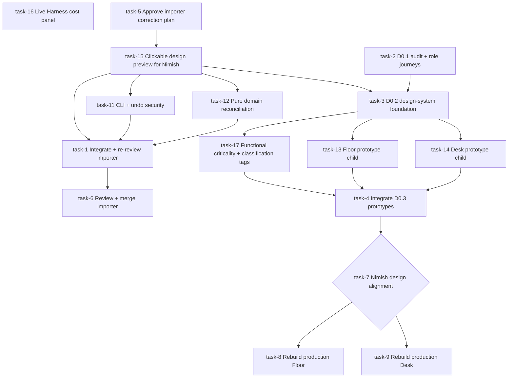

# Execution graph — current frontier

Updated 11 November 2026. This is the repo mirror of the live Agent Teams task board. The board owns
live ownership/status; this file preserves the graph, contracts and merge order across sessions.
The milestone goal is the DSH persisted goal `goal-37931532-6766-42d9-8777-937493a3ac39`.

## Goal loop

1. Show Nimish a small clickable Floor/Desk design preview and collect feedback before heavy UI work.
2. Finish the M1b importer safely and merge it through review + green CI.
3. Establish one coherent design language and reusable component foundation.
4. Let Nimish review clickable Floor and Desk prototypes before production frontend rebuilding.
5. Rebuild Floor and Desk from the approved system, then resume the actionable M1b frontier.
6. Stop at the M1b gate; begin M2 only after the required product-owner go decision.

Nimish approved the clean white preview baseline and requested richer functional colour: criticality,
machine condition/type and classification tags with a controlled accessible palette, icons and labels.
This is design information hierarchy, not M2 business logic or decorative colour.

The loop is objective → ready task → child execution → evidence → independent review → integration
→ recorded memory → re-evaluation. A red test/review returns to its owning task, not to the start.

## Current DAG

The two roots run in parallel. Floor and Desk production work remains blocked until the gate. Their
implementation may later fan out, but PRs still enter the merge queue one at a time.

## Ownership and write contracts

| Node               | Owner                           | Exclusive write scope                                                            |
| ------------------ | ------------------------------- | -------------------------------------------------------------------------------- |
| task-16            | cost-plugin child               | `tools/dsh-live-cost/` only; no product writes                                   |
| task-15            | design-preview child            | isolated `design-preview/` route, its E2E/evidence and ADR 0005                  |
| task-5             | import-planner child            | `docs/slices/M1b-import.md`                                                      |
| task-10            | import-schema child             | `schema.ts`, schema tests and `docs/spec/import/` only                           |
| task-11            | import-security child           | `cli.ts`, `security.ts`, `undo.ts` and focused tests only                        |
| task-12            | import-reconciliation child     | new `reconcile.ts` and focused tests only                                        |
| task-1             | importer integration child      | `bhavin.ts`, `insert.ts`, integration test; child scopes above after they merge  |
| task-6             | lead + fresh reviewers          | memory files listed on task-6; reviewers are read-only                           |
| task-2             | lead + fresh design-audit child | `docs/design/`, `docs/slices/D0-design-foundation.md`                            |
| task-3             | design-system child             | `apps/web/src/design-system/`, `apps/web/src/style.css`, `docs/DESIGN-SYSTEM.md` |
| task-17            | functional-tag child            | isolated Tag component, tag matrix/tests and `docs/design/TAG-SYSTEM.md`         |
| task-13            | floor-prototype child           | `apps/web/src/prototype/floor/` + Floor prototype E2E only                       |
| task-14            | desk-prototype child            | `apps/web/src/prototype/desk/` + Desk prototype E2E only                         |
| task-4 integration | lead                            | prototype shell/routes/shared fixtures and final integration                     |
| task-7             | Nimish (product gate)           | approval recorded in `docs/design/ALIGNMENT.md`                                  |
| task-8             | Floor implementation child      | Floor screens + Floor E2E only                                                   |
| task-9             | Desk implementation child       | Desk screens + Desk E2E only                                                     |

Shared package manifests, lockfiles, i18n catalogues, schema/migrations and prototype shared files
are lead-owned during each integration window. A child stops rather than editing outside its scope.
Every implementation task has its own branch/worktree and a fresh read-only reviewer.

## Merge queue

The task-15 throwaway preview is served locally for Nimish's feedback, not merged as production UI;
its approved decisions are absorbed into D0.2 or its route is deleted.

1. Importer correction plan is documentation within the existing importer branch.
2. task-1 + task-6: importer PR; merge only after fresh PASS and green CI.
3. task-2: D0.1 audit/role-journeys PR.
4. task-3: D0.2 tokens/components PR with rendered evidence.
5. task-4: one integrated D0.3 clickable-prototype PR.
6. task-7: explicit design-alignment decision; not a code merge.
7. task-8/task-9: separate production vertical-slice PRs, sequenced after their parallel build work.

Only one PR merges at a time. Rebase the next branch on the new `main` and rerun its required checks.
No batch merge, direct-to-main push, production deploy, or gate bypass.

## Memory and navigation

- `docs/HANDOFF.md`: current live/in-flight/next state, under 50 lines.
- `docs/plan/backlog.md`: milestone ticket dependencies and external blockers.
- `docs/plan/EXECUTION.md`: this active execution graph and child contracts.
- `docs/slices/`: deterministic file/interface/test contracts for each slice.
- `docs/spec/parity.yaml`: product parity evidence.
- `docs/adr/` and `docs/decisions/`: irreversible choices and rejected alternatives.
- `wiki/`: why that the code cannot express; `wiki/log.md` is append-only.
- DSH goal + Agent Teams board: live automatic continuation, owners, blockers and completion.

Obsidian/Graphify were not installed on 11 November 2026: no identified official bundle was
available, a second notes store would drift from the repo, and a code-visualisation graph would not
execute this build DAG. Reconsider a concrete navigation or viewing tool separately from execution.

## Orchestrator cadence

After every child report or task transition: inspect evidence, update the board, integrate only green
reviewed work, refresh this map when the graph changes, and update handoff/log at session end. Never
claim a milestone from activity; only its written gate and required human answer close it.

## Token efficiency

Baseline across 17 sessions on 11 November: **$50.60 estimated** — 2,830,980 uncached input,
727,594 output, 123,619,549 cached reads, zero cache writes, at K3.1 Global rates. The target is less
repeated input, not disabling cheaper cache reads.

- Construct short briefs; no fresh child for trivial work and no nested agents.
- Read named sections with grep + bounded reads. Hand off file paths/SHAs, never pasted plans or diffs.
- Batch related findings; one scoped re-review, not repeated whole-branch review rounds.
- Use scripts for mechanical checks/cost aggregation and early handoffs instead of expanding sessions.
- Keep user updates short and plain. Compare token/cost per comparable slice against this baseline and
  record the evidence here; do not claim savings from fewer agents or a different cache metric alone.
